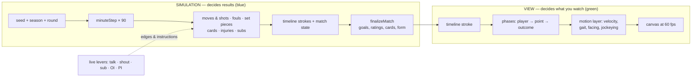
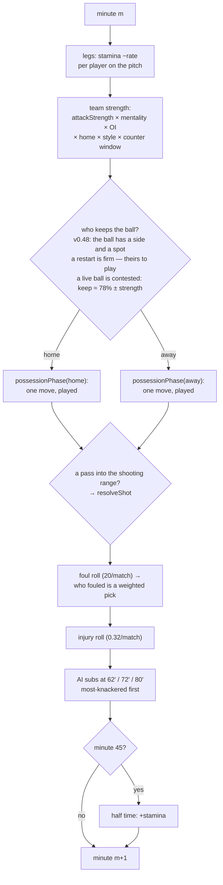
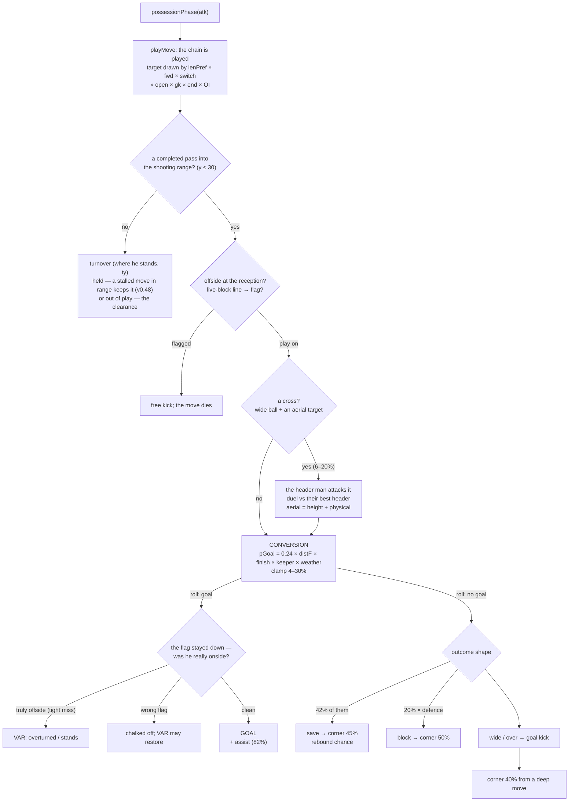
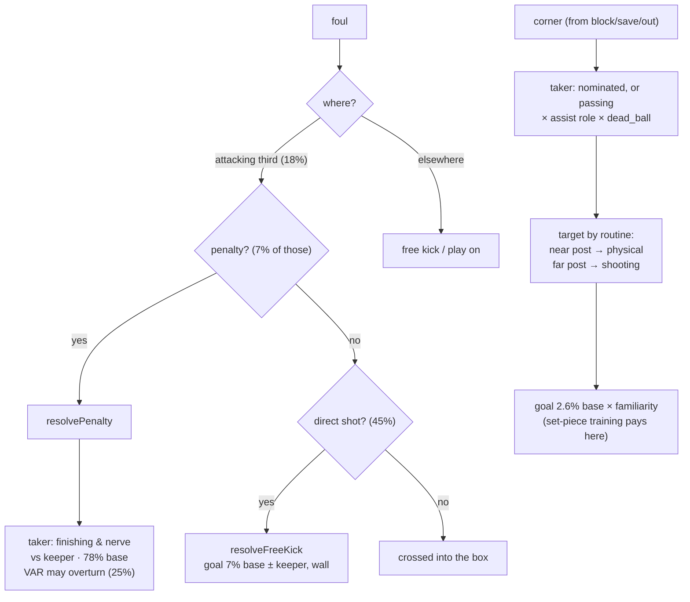
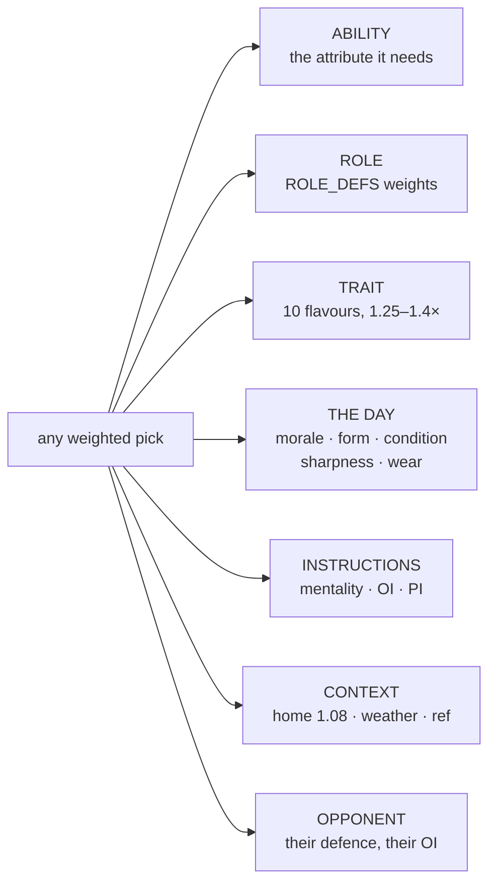
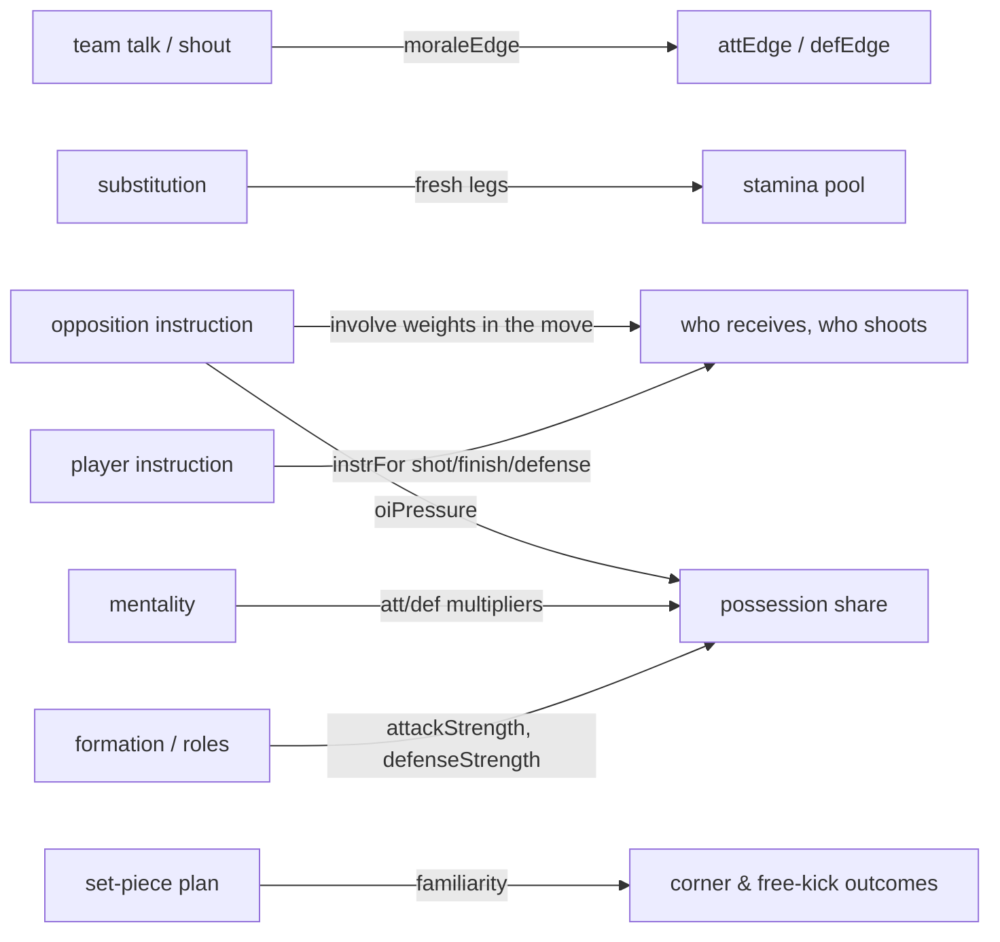
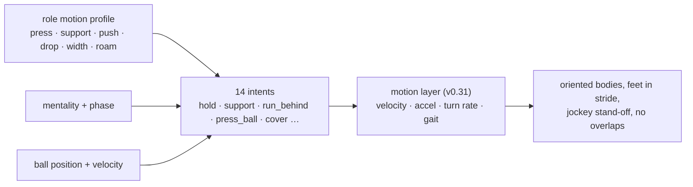
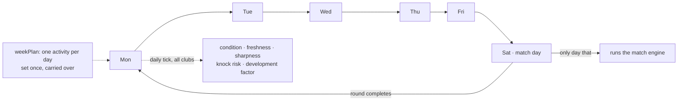

# The match engine, as pictures

*Read this with `docs/engine-map.html` open in a browser (click any box for the formula it hides). Everything here is drawn straight from the code — file and line references included.*

Two rules to hold in your head:

- **Blue = the simulation.** It decides results. Deterministic: same seed, same season, byte for byte.
- **Green = the view.** It decides what you *see* — movement, intents, facing. It never writes back.



## 1 · The minute loop

Every minute plays one possession move for the side that keeps the ball. There is no memory of "momentum" — only state (score, stamina, cards, instructions, and the ball: its side, its spot and whether it is live — `ballSpot`, v0.48).



## 2 · Inside a move — where individuals actually decide

This is the only place in the sim where *named players* make *choices*: who receives, who carries the ball into the box, who takes the shot the move produces, and what happens.



**What each pick multiplies** (the receiver weight, `possession.ts:230`):

```text
weight(receiver) =
    lenPref          a length preference peaked at 7 + 29·directness
  × fwd              forward bias scaled by risk
  × switch           a bonus for switching the play (× width)
  × open             1 − 0.5 × pressure on the receiver
  × gk               keeper discount (0.05)
  × end              the end boost — men in the shooting range on the final ball
  × oiInvolve        the opponent's marking on that man (compounded on the final ball)
```

## 3 · Set pieces and penalties — their own decision nodes



## 4 · The bias stack — what every weight is made of

Nothing is a coin flip on its own. Each pick multiplies a stack; remove any layer and the number changes.



## 5 · Where your live levers land



## 6 · The formula card

| # | What | Formula | Where |
|---|---|---|---|
| 1 | Who has the ball (v0.48) | the side that had it — a restart is firm; a live ball keeps it with `keep = clamp(keepBase + 2(1−keepBase)(p_side−½), 0.5, 0.95)` | `match.ts:1687` |
| 1b | Possession share (the prior retention bends to) | `pPossHome = clamp(0.5 + 0.35·(attH−attA)/(attH+attA) + 0.12·(retH−retA), 0.22, 0.78)` | `match.ts:1672` |
| 2 | Team attack (the possession prior) | `attackStrength(XI, roles, mentality) × homeAdvantage × oiPressure × style.att × transitionEdge` | `match.ts:1586` |
| 3 | Receiver weight (the move) | see §2 — lenPref × fwd × switch × open × gk × end × oiInvolve | `possession.ts:230` |
| 4 | Conversion | `0.24 × distF × (1+(finish−60)/120) × (1+(60−keeper)/160) × weather` → clamp 4–30%; `distF = clamp(1.25 − distGoal/42, 0.4, 1.15)` | `match.ts:773` |
| 5 | Per-player edge | `moraleEdge × staminaFactor × sharpness × wear × form × challenge` | `match.ts:94` |
| 6 | Fouls per match | `20/90` per minute × `conditionEffects.fouls` | `match.ts:1610` |
| 7 | Card share of fouls | `0.18 × weather × fouling tactics` → ≈ 3.6 cards/match | `match.ts:1027` |
| 8 | Stamina drain | `staminaDrainPerMinute(player)` — pace and physical set the rate | `match.ts:60` |
| 9 | Corner → goal | `0.026 × familiarityFactor(routine)` | `match.ts:1397` |
| 10 | Penalty | `0.78 ± shooting vs keeper`, VAR review 12% → overturn 25% | `match.ts:1092` |

## 7 · The view layer (green) — decisions with no consequences



## 9 · The week (between matches)



*Four training days = the baseline week (1.0× growth). Heavy weeks buy development and pay in freshness; light weeks do the opposite.*

## 8 · Code map

| File | What lives there |
|---|---|
| `src/engine/match.ts` | the whole sim: minute loop, moves & shots, fouls, set pieces, shootouts |
| `src/engine/possession.ts` | the played move: targets, dice, the chain (v0.46) |
| `src/engine/positions.ts` | `shapeFor` — the attack/defend geometry sim and view share (v0.46) |
| `src/engine/tuning.ts` | every constant in one table (`T`) |
| `src/engine/ratings.ts` | attack/defence strength, role scoring (`ROLE_DEFS`) |
| `src/engine/live.ts` | the manager's in-match levers, journaled as changes |
| `src/engine/intents.ts` | the 14 off-ball intents (view only) |
| `src/ui/motion.ts` | body physics for the picture (view only) |
| `src/ui/screens/MatchScreen.tsx` | the 60 fps loop: strokes → phases → canvas |

---

*Prefer to click instead of read? Open **`docs/engine-map.html`** — same content as an interactive map, no build step, works offline.*
